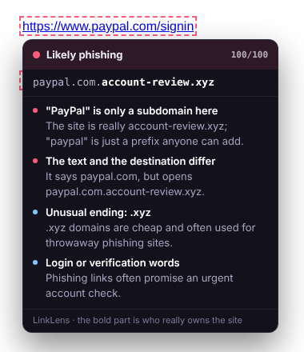
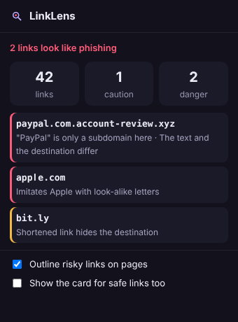

# LinkLens

🇷🇺 [Русская версия ниже](#ru)

**Hover a link, see where it really goes.** A Chrome extension that inspects links before you click: look-alike domains, letters borrowed from other alphabets, brand names used as a decoy subdomain, shortened links, and link text that promises one site while the link opens another.

**Try it without installing:** https://dav1dushka.github.io/linklens/ (a sample phishing email to hover, and a playground for any link)

<p>
  
  
</p>

## What it catches

| Trick | Example | Why it works on people |
| --- | --- | --- |
| Brand as a subdomain | `paypal.com.account-review.xyz` | We read left to right; the owner is the end of the name |
| Look-alike letters (IDN homographs) | `xn--80ak6aa92e.com` shown as `аррӏе.com` | Cyrillic `а р ӏ е` look identical to Latin letters |
| Typosquatting, digit swaps | `paypa1.com`, `arnazon.com`, `micros0ft-login.com` | One character is easy to miss |
| Text that lies | text `https://www.paypal.com/signin`, link to another site | People trust what they read, not the href |
| Credentials trick | `https://www.dropbox.com@files-share.example/` | Everything before `@` is a username, not the site |
| Raw IP addresses, `javascript:` and `data:` links | `http://192.0.2.44/support` | Real companies use domain names |
| Shortened links | `bit.ly/…` | The destination is hidden until you click |
| Weaker signals | no HTTPS, odd ports, cheap TLDs (`.xyz`, `.top`, `.zip`), long subdomain chains, "verify your account" words | Each adds a little to the score |

Every link gets a score from 0 to 100 and a level: **no warning signs**, **be careful**, or **likely phishing**. Any single strong sign (for example a homograph) is enough for "likely phishing"; weak signs only add up.

The card always shows the address with the part that decides who owns the site in **bold**, and underlines characters that are not plain ASCII.

## Privacy

LinkLens has no server and makes no network requests. Links are analysed in the page, in memory. The only permission it asks for is `storage`, to remember two settings.

## Install

1. Download `linklens.zip` from the [latest release](https://github.com/Dav1dushka/linklens/releases/latest) and unzip it.
2. Open `chrome://extensions` and turn on **Developer mode**.
3. Click **Load unpacked** and choose the unzipped folder.

Works in Chrome, Edge, Brave and other Chromium browsers.

## How it is built

```
src/analyze.ts   the rules: pure functions, no DOM, fully unit-tested
src/punycode.ts  RFC 3492 decoder, so xn-- names can be read
src/data.ts      frequently impersonated brands, URL shorteners, two-level suffixes
src/card.ts      the hover card, rendered in a closed shadow root so pages cannot restyle it
src/hover.ts     hover/focus handling and page scanning, shared by the extension and the demo
src/content.ts   content script (Manifest V3)
src/popup.ts     toolbar popup: page summary and settings
```

A few details worth knowing:

- **Who owns the site** is decided by the *registrable domain*: `login.example.co.uk` belongs to `example.co.uk`. LinkLens uses a small built-in list of two-level suffixes rather than the full Public Suffix List, which keeps it tiny but means rare suffixes are treated as normal TLDs.
- **Homographs** are detected by decoding punycode and reducing the name to a *skeleton* (`а→a`, `0→o`, `rn→m`, …) that is compared with brand names.
- **Typosquatting** uses edit distance, with stricter limits for short names so `apples.com` is not mistaken for Apple.
- The card also opens on keyboard focus, so it works for people who navigate with Tab.

## Development

```bash
npm install
npm test           # build the tests with esbuild and run them with node:test
npm run typecheck  # strict TypeScript
npm run build      # extension/ and demo/
npm run zip        # linklens.zip, ready to load
```

## Limits

Heuristics, not a blocklist: a brand-new phishing domain with no tricks in its name (say `secure-billing-center.com`) will only get the weak signals. LinkLens helps you notice; it does not replace thinking before typing a password.

## License

MIT

---

<a id="ru"></a>

# LinkLens — по-русски

**Наведи на ссылку — увидишь, куда она ведёт на самом деле.** Расширение для Chrome, которое проверяет ссылки до клика: домены-двойники, буквы из других алфавитов, название бренда в роли поддомена-приманки, сокращённые ссылки и текст ссылки, который обещает один сайт, а открывает другой.

**Попробовать без установки:** https://dav1dushka.github.io/linklens/ (пример фишингового письма, на ссылки в котором можно навести, и песочница для любой ссылки)

## Что ловит

| Приём | Пример | Почему срабатывает на людях |
| --- | --- | --- |
| Бренд в поддомене | `paypal.com.account-review.xyz` | Читаем слева направо, а владелец — это конец имени |
| Похожие буквы (IDN-гомографы) | `xn--80ak6aa92e.com` отображается как `аррӏе.com` | Кириллические `а р ӏ е` выглядят как латиница |
| Опечатки, замена цифрами | `paypa1.com`, `arnazon.com`, `micros0ft-login.com` | Один символ легко не заметить |
| Текст, который врёт | текст `https://www.paypal.com/signin`, ссылка на другой сайт | Люди верят тому, что читают, а не href |
| Трюк с учётными данными | `https://www.dropbox.com@files-share.example/` | Всё до `@` — имя пользователя, а не сайт |
| IP вместо домена, ссылки `javascript:` и `data:` | `http://192.0.2.44/support` | Настоящие компании используют доменные имена |
| Сокращённые ссылки | `bit.ly/…` | Адрес назначения скрыт до клика |
| Слабые признаки | нет HTTPS, странные порты, дешёвые TLD (`.xyz`, `.top`, `.zip`), длинные цепочки поддоменов, слова вроде «подтвердите аккаунт» | Каждый понемногу добавляет к оценке |

Каждая ссылка получает оценку от 0 до 100 и уровень: **признаков нет**, **осторожно** или **вероятно фишинг**. Одного сильного признака (например, гомографа) достаточно для «вероятно фишинг», слабые признаки только суммируются.

В карточке всегда показан адрес, где **жирным** выделена часть, определяющая владельца сайта, а символы не из ASCII подчёркнуты.

## Приватность

У LinkLens нет сервера, он не делает сетевых запросов. Ссылки анализируются прямо на странице, в памяти. Единственное разрешение — `storage`, чтобы помнить две настройки.

## Установка

1. Скачай `linklens.zip` из [последнего релиза](https://github.com/Dav1dushka/linklens/releases/latest) и распакуй.
2. Открой `chrome://extensions` и включи **Режим разработчика**.
3. Нажми **Загрузить распакованное расширение** и выбери распакованную папку.

Работает в Chrome, Edge, Brave и других браузерах на Chromium.

## Как устроен

```
src/analyze.ts   правила: чистые функции без DOM, полностью покрыты тестами
src/punycode.ts  декодер RFC 3492, чтобы читать имена xn--
src/data.ts      часто подделываемые бренды, сокращатели ссылок, двухуровневые суффиксы
src/card.ts      карточка при наведении в закрытом shadow root, чтобы страница не могла её перекрасить
src/hover.ts     наведение, фокус и сканирование страницы — общие для расширения и демо
src/content.ts   контент-скрипт (Manifest V3)
src/popup.ts     попап на панели: сводка по странице и настройки
```

Несколько деталей:

- **Владелец сайта** определяется по *регистрируемому домену*: `login.example.co.uk` принадлежит `example.co.uk`. LinkLens использует небольшой встроенный список двухуровневых суффиксов вместо полного Public Suffix List. Так расширение остаётся крошечным, но редкие суффиксы считаются обычными TLD.
- **Гомографы** находятся так: punycode декодируется, имя сводится к *скелету* (`а→a`, `0→o`, `rn→m`, …) и сравнивается с названиями брендов.
- **Опечатки** ищутся по расстоянию редактирования, с более строгими порогами для коротких имён, чтобы `apples.com` не принимался за Apple.
- Карточка открывается и при фокусе с клавиатуры, так что работает для тех, кто ходит по странице через Tab.

## Разработка

```bash
npm install
npm test           # собрать тесты через esbuild и запустить через node:test
npm run typecheck  # строгий TypeScript
npm run build      # extension/ и demo/
npm run zip        # linklens.zip, готовый к загрузке
```

## Ограничения

Это эвристики, а не чёрный список: новый фишинговый домен без трюков в имени (например, `secure-billing-center.com`) получит только слабые признаки. LinkLens помогает заметить подвох, но не заменяет привычку подумать, прежде чем вводить пароль.

## Лицензия

MIT
